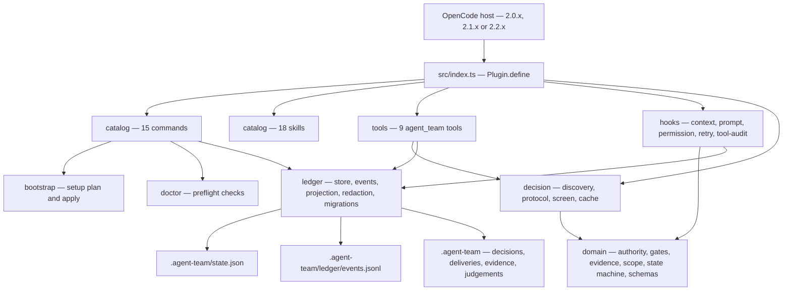
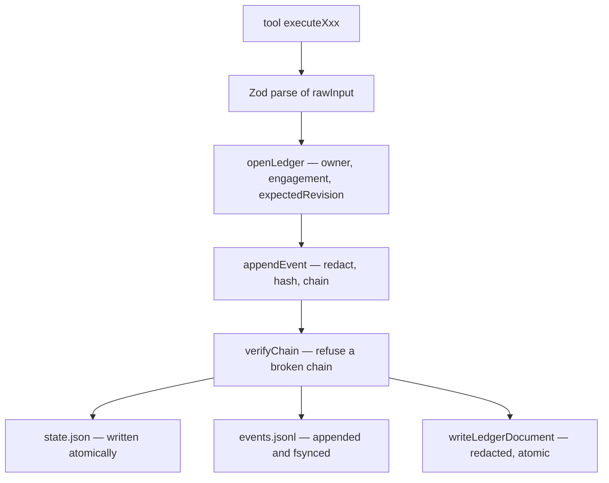
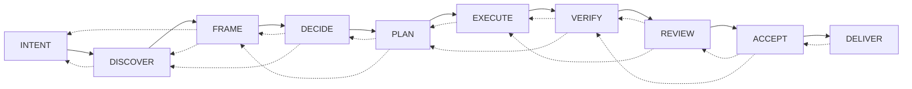

# Architecture

How Agent Team is put together: the boundaries, the data flow, and the design
decisions that produced them. For the product's behaviour, read
[README.md](README.md). For the rules that keep the system safe, read
[SECURITY.md](SECURITY.md).

## What it is

Agent Team is an OpenCode plugin. It does not replace the host, fork it, or run a
service. It registers commands, skills, tools and hooks inside a normal OpenCode
session, and it keeps its own state in the project directory.



## Package shape

There is no build step. `package.json` exports `./src/index.ts` and publishes `src`,
`assets` and `schemas` (plus README, LICENSE and CHANGELOG); the OpenCode host loads
the TypeScript source directly.

Two consequences shape the code:

- **`assets/` is read from disk at runtime.** `packageRoot()` resolves the
  installed package directory, and the agent templates, skill files and the
  plugin's own `package.json` (for the version the doctor reports) are read from
  there. A published package missing `assets/` is broken even though every test
  passes — which is why `npm run pack:check` inspects the tarball.
- **`schemas/` is published but not read at runtime.** It is the machine-readable
  contract for consumers, generated from the Zod source.

## Module map

| Module | Responsibility |
|---|---|
| `src/index.ts` | The plugin entry. `Plugin.define`, then four parallel registrations |
| `src/runtime.ts` | The runtime handle (host context + parsed options) and the `toolOk` / `toolErr` helpers |
| `src/options.ts` | The Zod option schema and its defaults |
| `src/catalog/` | Commands, skills, agent templates, model options — the surfaces registered with the host. Command registration also drives setup and the doctor |
| `src/tools/` | One file per tool: a closed input schema and its executor |
| `src/hooks/` | Host hook handlers: session context, prompt, permission, retry, tool audit |
| `src/domain/` | Pure logic: authority matrix, gate algebra, evidence rules, scope matching, phase machine, all Zod schemas |
| `src/ledger/` | The event store, the hash chain, the projection, redaction, migrations, schema generation |
| `src/bootstrap/` | `/agent-team/setup`: planning and applying the native agent files and the configuration. `scope.ts` is the single source of paths for a scope, consumed by both the plan and the apply; `decisions.ts` resolves the two decisions the command asks about; `templates.ts` renders the leader title |
| `src/doctor/` | Preflight checks and the report renderer |
| `src/decision/` | The decision capability: catalog discovery, the host protocol, the state screen and the held decisions |
| `src/compat/` | Host version and host API surface detection |
| `src/util/` | Paths and containment, atomic writes, hashing, id generation |

The dependency direction is one-way: `src/util/` imports nothing from the project and
`src/domain/` imports only from `src/domain/` and `zod`; `src/ledger/` depends on
`domain/` and `util/`; `src/decision/`, `tools/` and `hooks/` depend on both.
`domain/` never imports from `tools/` or `src/decision/`, which is what keeps the
gate algebra, the authority matrix and the decision verdict testable without a
host.

## The ledger

State is event-sourced. `.agent-team/` holds:

```
.agent-team/
  README.md               # what the directory is
  state.json              # the current projection
  ledger/events.jsonl     # append-only, hash-chained event log
  decisions/              # DEC-0001.md
  deliveries/             # DEL-001.yaml
  evidence/               # EVD-0001.json, artifacts/
  judgements/             # JDG-XXXXXXXX.json — one per executed decision
  approvals/
  exports/
  setup-backups/          # created by setup and by a state file migration
```

`state.json` is derived. `ledger/events.jsonl` is the source of truth. Every event
carries `sequence`, `previousHash` and `hash`, where the hash covers the
canonical event body. The chain is verified before every append; a broken chain
refuses the write rather than repairing itself.



### The write protocol

Every mutating tool follows the same three steps, and the guard lives in one place
(`src/tools/ledger.ts`) rather than in eight copies that could drift:

1. **Parse** the raw input with the Zod schema for that tool.
2. **Open the ledger** (`openLedger`): assert the caller is the ledger owner, assert
   the engagement exists, and assert that `expectedRevision` still matches the
   current revision. A stale revision is refused — this is optimistic concurrency,
   and it is what keeps parallel specialists from clobbering each other.
3. **Append** the event (`appendEvent`), which redacts the payload, extends the
   hash chain, and writes both the event log and the new projection.

Two paths do not go through `openLedger`, both by design:

- `agent_team_state` with `action: "initialize"` asserts the ledger owner and
  then calls `initializeState`. There is no revision to check — there is no
  state yet — and initialising twice is idempotent.
- `/agent-team/guard` appends its `guardrails.updated` event directly, with the
  actor recorded as `plugin`. The operator is changing the autonomy policy
  through the command, not the leader acting through the ledger, and routing it
  through the leader would make a guardrail depend on a model turn.

`initializeState` also writes the projection itself rather than going through
`appendEvent`, so it applies the redactor on its own. Without that, the initial
`state.json` would be the only unredacted write in the ledger — and it would
disagree with the event that records the same outcome.

The ledger lock (`withLedgerLock`) is **per-process**, with a five-second timeout.
It serialises concurrent writes inside one OpenCode server. It does not protect
against a second process — the hash chain and the revision guard are what do that,
and a broken chain fails closed.

### Ownership

**Only `team-leader` writes the ledger.** A specialist returns a
`SpecialistResult@1`; the leader records it. This is what makes "one accountable
orchestrator" mechanical rather than a convention, and it is why parallel
specialists cannot contend on the revision. `agent_team_handoff` with
`action: "prepareWave"` books a whole wave in one call and therefore one revision.

**One directory is the exception.** `judgements/` holds one document per
executed decision, written by whichever specialist ran the decision. It is
outside the hash chain, outside the revision guard and outside the owner guard,
because a document that contends for the revision would defeat the purpose of a
cheap first pass. The audited party can therefore edit its own judgement
document; it is a record of what was asked, not tamper-evident proof of it.

### The projection

`src/ledger/projection.ts` turns the full state into a compact
`StateProjection`, rendered as YAML and injected into every Agent Team session by
the context hook. The projection is what the leader reads; the event log is what
the system audits. `/agent-team/status` answers from the projection and is
instructed never to dump the raw event log.

## The delivery loop

The engagement moves through a fixed phase sequence. Forward steps are one phase
at a time; the declared backward edges allow a return to an earlier phase when
discovery or verification invalidates a later assumption.



`src/domain/state-machine.ts` holds the order and the backward edges, and
`validatePhaseTransition` refuses a jump that is not declared.

## The gates

Seven gates — `INTENT`, `DISCOVERY`, `PLAN`, `VERIFY`, `REVIEW`, `ACCEPT`,
`DELIVER` — are evaluated **deterministically by the plugin from ledger state**.
The model never chooses a gate result; it supplies the claim, and the gate
decides.

Three properties make the gates meaningful:

- **CLAIM ≤ EVIDENCE.** A gate refuses a claim that is stronger than the evidence
  behind it. A delivery cannot claim production health on the strength of unit
  tests, however many criterion-linked rows it carries.
- **A criterion needs proof.** A criterion is satisfied only by a `pass` row that
  carries an artifact reference, a command or a digest. In `strictEvidence` mode a
  `partial` row does not satisfy anything. A summary-only row never satisfies a
  criterion in either mode.
- **Review must be independent.** `REVIEW` and `ACCEPT` require a completed
  `team-leader/reviewer` handoff whose scope overlaps the implementation's scope.
  "A reviewer handoff exists" is not enough — a reviewer pointed at nothing
  cannot pass the gate, and self-review never passes.

The `ACCEPT` gate records a digest of the delivery contract it judged. The
`DELIVER` gate recomputes it and refuses a contract that changed after it was
accepted, so nothing can be promoted that nobody accepted. `DELIVER` also requires
a passing `ACCEPT` and no pending approval; a pending approval makes the gate
`BLOCKED` rather than `FAIL`, because it is waiting, not failing.

## The authority matrix

`src/domain/authority.ts` decides what a tool call may do. It is an ordered list
of rules; the last matching rule wins.

- The baseline is **ALLOW**, including external, destructive, production,
  financial and legal actions. Autonomy is the default, deliberately.
- Only the **integrity rules** may return `DENY`: secret exposure, unproven
  completion claims, instructions found in untrusted content, and non-orchestrator
  creation of `team-leader/*` agents. `DENY` is final.
- A trailing check outside the rule list denies anything whose action name
  mentions a credential (`secret`, `token`, `bearer`, `password`) *and* exposure
  (`expos`), even when no listed rule matched it. It is a backstop: an action
  named `expose-token` is denied without anyone having to write a rule for it.
- `ASK` is not produced by the base matrix. It comes only from a user-registered
  guardrail (`autonomy.askBefore`, `/agent-team/guard`) or the explicit
  `autonomy.mode: "guarded"` opt-in.
- **The matrix fails closed.** A rule whose matcher throws is treated as `DENY`,
  not as "did not match" — otherwise a broken `DENY` rule would fall through to
  `ALLOW`.

The role capability boundary is enforced separately, by the context hook, which
removes tools a role must not have. `team-leader/explorer` loses `edit`, `write`,
`patch` and `shell`. The five read-only roles — explorer, product, architect,
reviewer and security — lose `subagent`, because a helper agent could edit or shell
and would make the read-only contract unenforceable. (Product and architect are
still granted a narrow edit scope of their own `.agent-team` artifacts, which the
templates declare explicitly.)

## The roster and the skill map

Ten agents: `team-leader` plus the explorer, product, architect, designer, coder,
worker, reviewer, security and release specialists.

- The **templates** in `assets/agents/` are the source. `/agent-team/setup`
  materializes them into `.opencode/agents/`, preserving a user-edited file and
  reporting it as drifted rather than overwriting it. The same command
  materializes them into `~/.config/opencode/agents/` under `--scope global`,
  so the roster is available in every project.
- **One scope value decides where an installation writes.** `src/bootstrap/scope.ts`
  resolves the configuration directory, the agents directory, the configuration
  file, the backup directory and the path of every managed template. The plan
  and the apply both take it, so a dry run names the file the apply writes.
  The global scope follows the host's own convention — `XDG_CONFIG_HOME` when
  it is set, the home directory's `.config` otherwise. The project scope backs
  up to `<project>/.agent-team/setup-backups/<ts>/` and the global scope to
  `<globalConfigDir>/.agent-team/setup-backups/<ts>/`, so the copy of a
  modified configuration file sits beside the file it protects.
- **The managed marker carries the title.** Every file the plugin installs ends
  with a marker recording its version, the checksum of its body and — for the
  leader — the title it was installed with, encoded so the marker stays one
  line of tokens. The title is read back from there, which is what lets an
  update preserve it.
- **Two decisions are the user's.** Whether the installed roster becomes the
  default agent, and what the team leader is called. Both are settled by a
  flag, and when no flag settles them the setup asks through the agent in the
  session and writes nothing until the answer comes back. The title is the
  label at the head of the leader's description, because the host derives an
  agent's visible name from its file and exposes no other label.
- The **skill map** in `src/catalog/skills.ts` maps 18 skills onto roles. It is
  injected into the role's system prompt, so skill awareness is deterministic
  rather than remembered. The map and the templates' `## Skills` blocks are
  compared by a test, so they cannot drift apart silently.
- **Only `team-leader` may create `team-leader/*` agents.** Specialists may launch
  the host's built-in helper agents, but never a sibling specialist.

## Host compatibility

The plugin is verified against `@opencode/plugin` 2.0.10, 2.1.4 and 2.2.0. Two
things change across those lines, and both are handled in `src/compat/host.ts`:

- The generation API moved. `ctx.experimental.generate.text` is the full API on
  2.2.x; `ctx.generate.text` is the fallback for 2.0.x and 2.1.x and is
  deprecated on 2.2.x. The plugin **resolves the surface by feature detection, not
  by version number**, so it survives the next rename.
- Optional surfaces appear over time (`ctx.credential`, `ctx.permission.assert`).
  The plugin does not depend on them; the doctor reports them so an operator can
  see the host they are actually running.

Anything not declared in the oldest supported typings is read through an `unknown`
view and narrowed, never assumed to exist at compile time.

## The bench

`bench/` is a separate evaluation system, not part of the plugin runtime. It
defines cases, a rubric, and a runner that drives a real OpenCode and scores the
artifacts the run produced.

- **Dry mode** (`npm run bench`) validates every case definition and reports each
  case as `not-evaluated`. An unknown invariant name or an incoherent case fails
  the run.
- **Model mode** (`npm run bench:model`) runs each case against a real model and
  scores it against the rubric.
- **Scoring is honest about what it measured.** A dimension the case does not
  exercise is reported as `null`, not zero. A run that was cut off is reported as
  incomplete and excluded from the mean. Only `authority`, `evidence` and
  `tool_economy` and `calibration` are machine-scored; `decision_quality` and `communication` need
  a human and are reported as unscored.

`bench/rubrics/README.md` is the human-facing contract and must stay in step with
the machine-scored map in `bench/runners/run.ts` and the checkers in
`bench/runners/observables.ts`.

## Design decisions

The reasoning behind each shipped change is recorded in
[CHANGELOG.md](CHANGELOG.md), including the failure that motivated it. The
decisions that shaped the architecture rather than a single release:

| Decision | Why |
|---|---|
| Autonomy defaults to ALLOW | The method is autonomous; a human in the loop on every action defeats it. Guardrails remain available for the operator who wants them |
| `DENY` is final and integrity-only | Guardrails that can be weakened are not guardrails. Authorization to *ask* is a policy event; refusal is a rule |
| The leader owns the ledger | Parallel specialists would contend on the revision, and accountability would become a convention rather than a mechanism |
| Gates are computed, not chosen | A model-selected gate result is a model opinion. The gate reads the ledger |
| Evidence is criterion-linked and must carry proof | A delivery claim without proof is a preference, and a summary is not evidence |
| The ledger is event-sourced with a hash chain | Tamper evidence and a reconstructable history, at the cost of a projection to maintain |
| The host surface is detected, not versioned | The plugin must not brick on a host line it has never seen |
| The package ships source | One artifact, no build step, no drift between what is tested and what is published |
